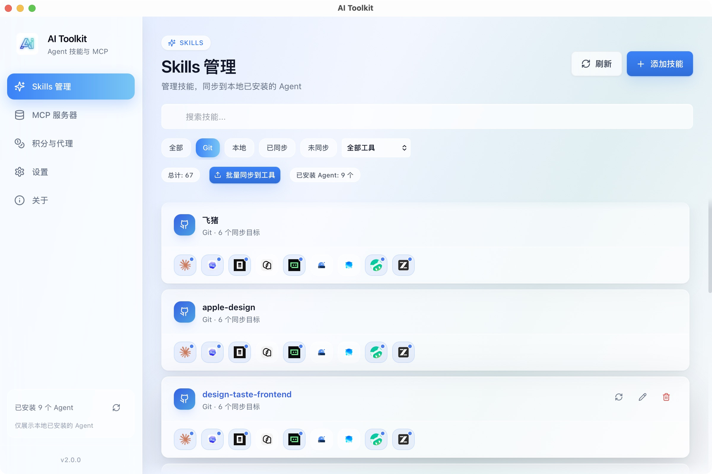
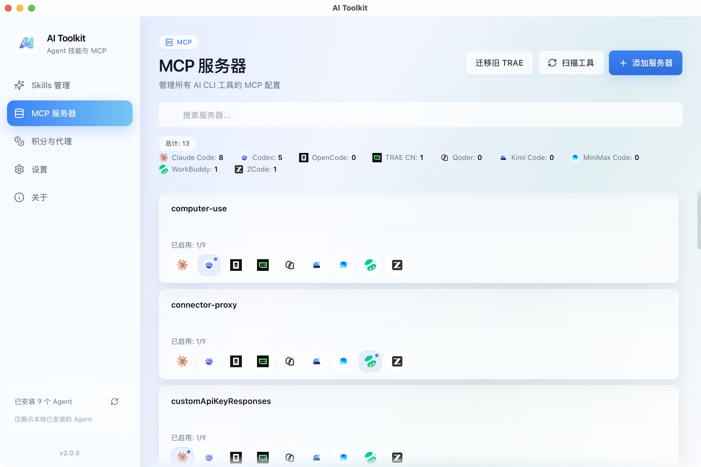
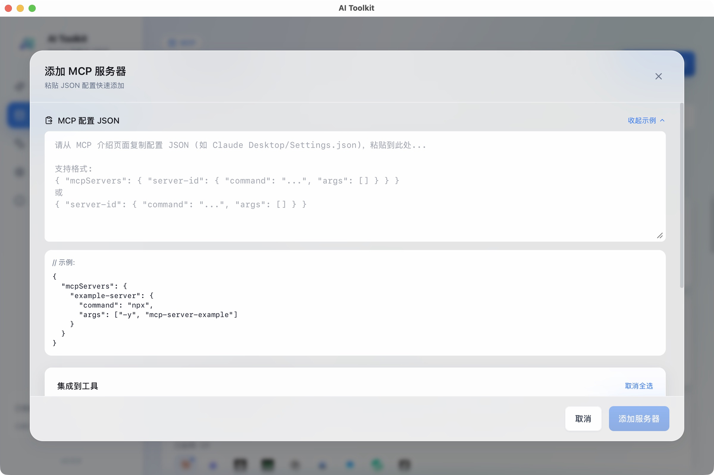
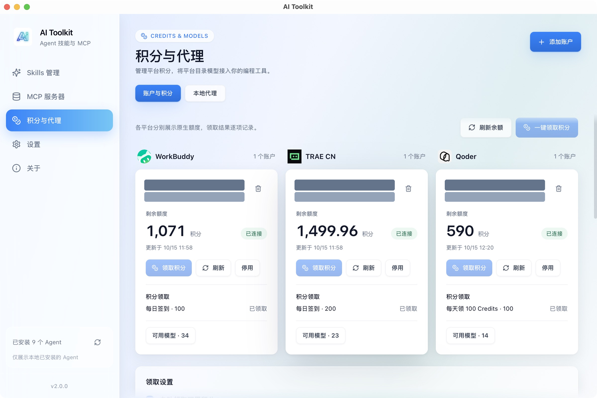
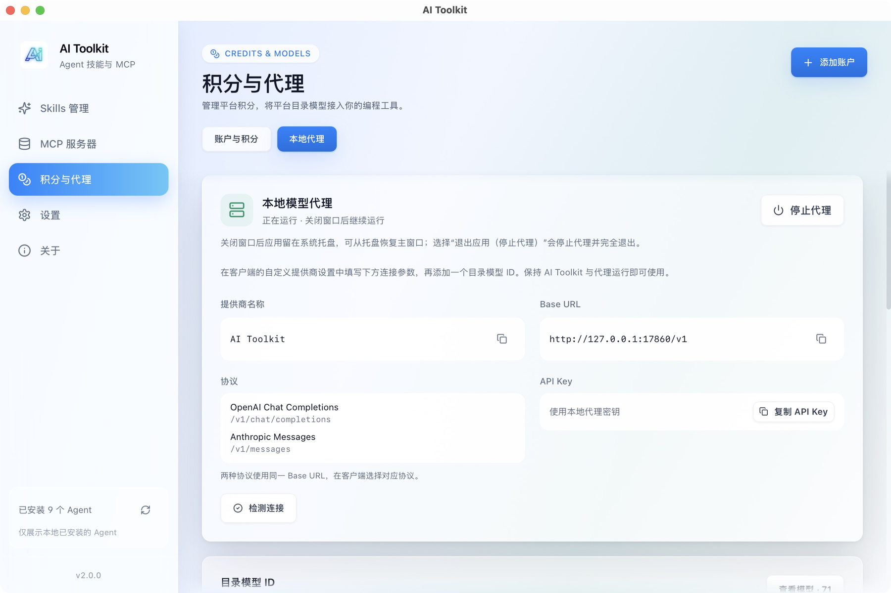
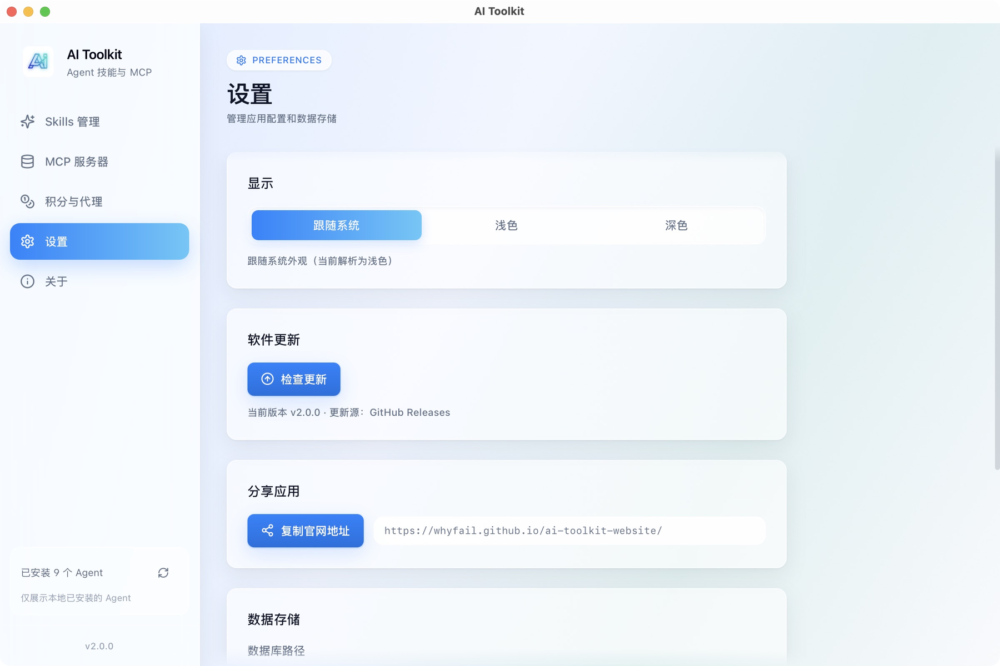

# AI Toolkit

<div align="center">

[](https://github.com/whyfail/AI-Toolkit/releases)
[](https://github.com/whyfail/AI-Toolkit/releases)
[](https://tauri.app/)

[中文](README.md) | [English](README_EN.md)

[Website](https://whyfail.github.io/ai-toolkit-website/) · [Download](https://github.com/whyfail/AI-Toolkit/releases/latest) · [Changelog](CHANGELOG.md)

</div>

## 📖 Introduction

AI Toolkit is a desktop manager for **MCP servers, Skills, platform credits, and a local model proxy**. The current version has five panels: Skills, MCP Servers, Credits & Proxy, Settings, and About, with local installation detection and configuration adapters for 24 AI programming tools.

## ✨ Key Features

### 🎯 MCP Server Management
- Support for **24** mainstream AI programming tools: Qwen Code, Claude Code, Codex, Gemini CLI, OpenCode, TRAE, TRAE CN, Qoder, Qoder CLI, CodeBuddy, Hermes Agent, Mimo Code, Kimi Code, MiniMax Code, WorkBuddy, ZCode, Cursor, Windsurf, Cline, Roo Code, Kilo Code, Continue, Goose, Kiro
- Add, edit, and delete MCP servers in a single interface
- Automatically detects installed AI tools on your system and prompts for MCP sync when new tools are discovered
- Toggle switches **sync in real-time** to the corresponding tool's configuration file
- **JSON Paste Mode**: Copy JSON configuration directly from an MCP introduction page and paste to recognize
- **Batch Import Preview**: Paste multiple MCP Server configs and import selected entries at once
- **Connection Testing**: Built-in test connection function to ensure server configurations are valid before saving

### 🧰 Skills Management
- **Skills Panel**: Dedicated Skills management interface for centralized skill management
- **Install Location Switch**: Choose the official `~/.agents/skills/` directory or `~/.ai-toolkit/skills/` as the central Skills location
- **Batch Sync**: Click to select multiple Skills in the sync modal and sync them to multiple target tools at once
- **Git Installation**: Install Skills from GitHub/GitLab repositories with automatic repository structure parsing
- **Online Search**: Search trending Skills from skills.sh
- **Featured Recommendations**: Browse featured Skills with install counts and star information
- **One-Click Update**: Auto-detect Skills with updates available and quick update support
- **Delete Confirmation**: Confirm before deletion that the Skill will be removed from the central repository and all synced tools; the operation cannot be undone
- **Sync Progress and Conflict Strategy**: Batch sync shows per-item progress; duplicate Skill names can be renamed, skipped, or overwritten

### 🪙 Credits & Model Proxy
- **Multi-Platform Accounts**: Connect WorkBuddy, TRAE CN, and Qoder accounts via the official authorization flow or by importing existing Token/credential JSON; credentials are stored in the system credential store
- **TRAE CN One-Click Import**: Prefers the local desktop app's login state and falls back to CLI keychain credentials; identity is verified and credits synced after import
- **Credit Display & Claiming**: Shows platform-native balances, update times, credit packs, and claim eligibility; claim available credits in one click, with coupons listed separately
- **Qoder Daily Event**: Claims credits directly through the official daily credit event API; if the official device-verification helper is installed, no need to open the Qoder app
- **Optional Auto-Claim**: Off by default; when enabled, checks and claims daily at 10:30 Beijing time while the app is running, and makes up a missed check if the app starts after 10:30
- **Local Model Proxy**: Manually start a service compatible with both OpenAI Chat Completions and Anthropic Messages, defaulting to `http://127.0.0.1:17860/v1`; copy a dedicated proxy API Key, keep it running after closing the window, and stop it by quitting from the tray
- **Real Model Catalog**: Prefixed model IDs pin the account catalog model and are rejected when the upstream returns a different variant; cross-platform aliases route only between verified models, preferring credits that expire soonest
- **Credential Security**: Uses Keychain on macOS, Credential Manager on Windows, and Secret Service on Linux; startup and background requests never trigger authorization prompts—authorization needs return explicit errors
- **Universal Client Setup**: Copy the Base URL, API Key, and model ID from the proxy page and add a custom provider with the protocol your client supports

Platform APIs and account permissions determine the actual availability of balances, claiming, and inference; unsupported capabilities show their status. The current implementation still requires real-account integration testing; local checks or test results must not be treated as GLM being fully available on all three platforms. See [Credits & Model Proxy](docs/credits-proxy.md) for details.

### 🔧 Developer Friendly
- Click on a tool name to quickly open the corresponding configuration file
- Visual interface, goodbye manual editing of JSON/TOML files
- Automatic recognition of multiple configuration file paths
- **Atomic Writing**: Temporary file + rename mechanism to prevent configuration corruption
- **Code Quality Checks**: `pnpm lint` / `pnpm check` use Oxlint and TypeScript to check the frontend

### 🔎 Installed Tool Detection
- Scans installed CLI tools, desktop apps, and IDE extensions at startup; the results determine the available sync targets for MCP and Skills
- Detection evidence comes from executables, app bundles, or IDE extension manifests; leftover config and Skills directories do not count as installations
- Codex CLI, desktop, and IDE share one Codex entry; both WorkBuddy editions share one WorkBuddy entry
- Kimi Code and MiniMax Code support desktop and CLI discovery, official icons, MCP, and Skills sync
- See [Agent adapter paths and official sources](docs/agent-adapters.md)

### 🔄 App Updates & Sharing
- **Startup Update Check**: Automatically checks for new releases on first launch and lets users decide whether to install
- **One-Click Sharing**: Copy the official website URL from Settings to share the app easily

### 📌 System Tray
- Closing the main window keeps the app in the system tray; an active proxy and background tasks continue running
- Restore the window from the tray's Open Main Window menu item, or launch the app again to activate the existing instance
- Quit App (Stop Proxy) exits the app and stops the proxy; `Cmd+Q` on macOS also exits

## 📸 Screenshots

These screenshots were captured from the actual macOS AI Toolkit v2.0.0 window on October 15, 2026. Nicknames, account IDs, and personal paths are redacted where visible. Credit balances and model status reflect only the accounts at capture time. The application UI shown is in Chinese.

### Skills

View Skill sources and sync status, filter by tool, and sync multiple Skills at once.



### MCP Servers

View servers and their enabled tools, then paste JSON to add a new configuration.



<details>
<summary>View the Add MCP Server dialog</summary>



</details>

### Accounts & Credits

View platform-native balances, claim status, and model catalogs for WorkBuddy, TRAE CN, and Qoder.



### Local Model Proxy

Copy the Base URL, proxy API Key, and model ID to connect a client using the OpenAI or Anthropic protocol.



<details>
<summary>View Settings</summary>



</details>

## 🖥️ System Support

| System | Status | Description |
|--------|--------|-------------|
| **macOS 12+** | ✅ Supported | Full feature support |
| **Linux** | 🚧 In Progress | Basic functionality available |
| **Windows 10+** | ✅ Supported | MCP and Skills management are supported |

## 🚀 Quick Start

Choose an installer from the [latest Release](https://github.com/whyfail/ai-toolkit/releases/latest): `AI_Toolkit-<version>-macOS-aarch64.dmg` for macOS Apple Silicon, or `AI_Toolkit-<version>-Windows-x64.msi` for Windows x64.

### macOS Installation

Open the downloaded `.dmg` and drag `AiToolkit.app` to Applications. Older builds use `AI Toolkit.app`; use the name included in your installer. The commands below use the current build name, so adjust the app name and mount path for older builds.

```bash
# Mount DMG
hdiutil attach "AI_Toolkit-<version>-macOS-aarch64.dmg"

# Drag to Applications folder
cp -R "/Volumes/AiToolkit/AiToolkit.app" /Applications/
```

### Windows Installation

Run the `.msi` installer, follow the setup wizard, and open AI Toolkit from the Start menu.

### First Use

1. Open the app and wait for local Agent detection. Installed tools become the available MCP and Skills sync targets.
2. In Skills, add a local Skill or Git repository, then choose Skills and target tools to sync.
3. In MCP Servers, paste configuration JSON, review the selected tools, and save.
4. To use credits or the model proxy, connect an account in Credits & Proxy and follow the [proxy setup guide](docs/credits-proxy.md).

### ⚠️ macOS Security Warning (Required for First Run)

Since the current version is not code-signed or notarized by Apple, macOS Gatekeeper may block it on first launch, showing **"Cannot be verified"** or **"File is damaged"**. Follow these steps to allow it:

**Method 1 (Terminal Command - Recommended):**
1. Drag the app to your `/Applications` folder
2. Open **Terminal** and run the following command:
   ```bash
   sudo xattr -cr "/Applications/AiToolkit.app"
   ```
3. Enter your Mac password and press Enter (characters won't be displayed). Once the command finishes, you can double-click to open.

**Method 2 (Right-Click Open):**
1. Locate `AiToolkit.app` (or `AI Toolkit.app` for older builds) in **Finder**
2. **Right-click** (or `Control + Click`) the app icon
3. Select **"Open"** from the context menu
4. Click **"Open"** again in the system warning dialog

**Method 3 (System Settings):**
1. Open **System Settings** -> **Privacy & Security**
2. Scroll down to the **Security** section
3. Find the message `"AI Toolkit" was blocked from use...`
4. Click **"Open Anyway"** and enter your password if prompted

## 📁 Supported AI Tools & Configuration Paths

| Tool | Configuration Path |
|------|-------------------|
| Qwen Code | `~/.qwen/settings.json` |
| Claude Code | `~/.claude.json` |
| OpenAI Codex | `~/.codex/config.toml` |
| Google Gemini CLI | `~/.gemini/settings.json` |
| OpenCode | `~/.config/opencode/opencode.json` |
| Qoder | `~/Library/Application Support/Qoder/SharedClientCache/mcp.json` |
| Qoder CLI | `~/.qodercli/settings.json` |
| TRAE (International) | `~/Library/Application Support/Trae/User/mcp.json` |
| TRAE CN (China) | `~/Library/Application Support/Trae CN/User/mcp.json` |
| CodeBuddy | `~/.codebuddy/mcp.json` |
| Hermes Agent | `~/.hermes/config.yaml` |
| Mimo Code | `~/.config/mimocode/mimocode.json` |
| Kimi Code | `~/.kimi-code/mcp.json` (supports `KIMI_CODE_HOME`) |
| MiniMax Code | `~/.minimax/mcp.json` (supports `MINIMAX_DATA_DIR`, `MAVIS_DATA_DIR`) |
| WorkBuddy | `~/.workbuddy/.mcp.json` |
| ZCode | `~/.zcode/cli/config.json` |
| Cursor | `~/.cursor/mcp.json` |
| Windsurf | `~/.codeium/windsurf/mcp_config.json` / `~/.config/devin/mcp_config.json` |
| Cline | `~/.cline/data/settings/cline_mcp_settings.json` |
| Roo Code | `<IDE User>/globalStorage/rooveterinaryinc.roo-cline/settings/mcp_settings.json` |
| Kilo Code | `~/.config/kilo/kilo.json` / `kilo.jsonc` |
| Continue | `~/.continue/config.yaml` |
| Goose | `~/.config/goose/config.yaml` / `~/Library/Application Support/Block/goose/config.yaml` |
| Kiro | `~/.kiro/settings/mcp.json` |

The international and China editions of WorkBuddy share the same application name and the same `~/.workbuddy` configuration, MCP, and Skills directories, so they cannot coexist. Installing the other edition replaces the application without deleting shared data. On Windows, the shared paths are `%USERPROFILE%\.workbuddy\.mcp.json` and `%USERPROFILE%\.workbuddy\skills\`.

TRAE has two management entries: the international edition and the China edition. Agent and IDE in each new edition share local MCP configuration and the Skills directory (`~/.trae/skills` internationally and `~/.trae-cn/skills` in China), so Work is no longer a separate sync target. Legacy `TRAE Work`, `TRAE Work CN`, and `TRAE SOLO CN` installations and configuration remain detectable and can be previewed and migrated to the new edition. Existing configuration IDs and synced Skills records remain readable. This integration manages local configuration; cloud Agents are outside its scope.

Use “迁移旧 TRAE” on the MCP page to preview and select legacy configuration. Conflicting server IDs require a new name. Migration creates a backup and supports undo, which stops if later edits would be overwritten. Legacy Windows skills in `%APPDATA%\Trae\skills` and `%APPDATA%\Trae CN\skills` appear as read-only sources on the Skills page. Import them manually before syncing to the new edition; source files are retained.

## 🧑‍💻 Local Development

Install Node.js 20+, pnpm 9, Rust stable, and the Tauri 2 build prerequisites for your platform, then run from this repository:

```bash
pnpm install --frozen-lockfile
pnpm tauri:dev
```

Use the desktop window launched by Tauri. `pnpm dev` only starts the frontend server; opening it in a browser displays “Please open in the desktop app” and cannot access local MCP configuration, Skills, or system credentials.

```bash
pnpm check
cargo test --manifest-path src-tauri/Cargo.toml
pnpm tauri:build
```

More documentation: [Agent adapters and paths](docs/agent-adapters.md) · [Credits & Model Proxy](docs/credits-proxy.md) · [Screenshot updates and redaction](docs/screenshots.md). These detailed guides are currently in Chinese.

## 🛠️ Tech Stack

- **Frontend**: React 18 · TypeScript · Vite · TailwindCSS · TanStack Query
- **Backend**: Tauri 2 · Rust · SQLite (rusqlite)

## 📄 License

MIT License

---

<div align="center">
  <p>Made with ❤️ for AI Developers</p>
</div>
